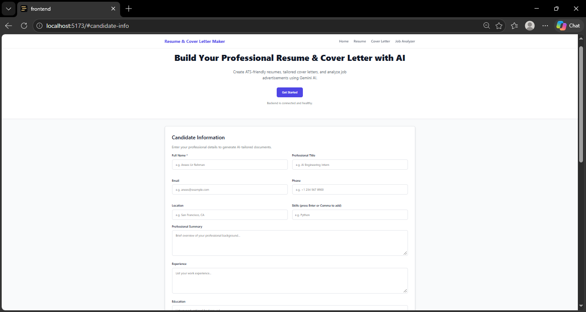
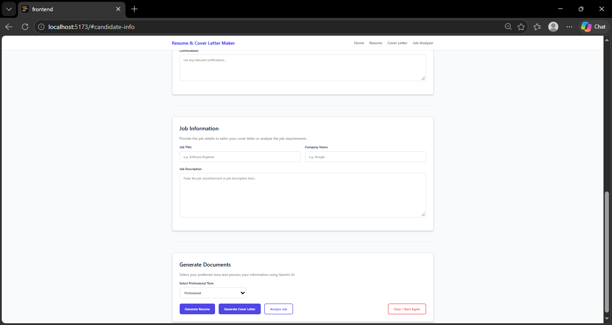

# AI Resume and Cover Letter Maker

## Description
AI Resume and Cover Letter Maker creates tailored resumes, job specific cover letters, and keyword analysis from candidate profiles and job descriptions. It helps job seekers and professionals prepare targeted job applications for specific roles.

## Live Demo
https://github.com/aneesofficial/AI-Resume-and-Cover-Letter-Maker

## Tech Stack
* Python
* FastAPI
* Uvicorn
* Google Gemini API
* React
* Vite
* JavaScript
* CSS

## Getting Started

### Prerequisites
* Python 3.10 or higher
* Node.js 18 or higher

### 1. Clone the repository
```bash
git clone https://github.com/aneesofficial/AI-Resume-and-Cover-Letter-Maker.git
cd Resume-and-cover-letter-maker
```

### 2. Install backend dependencies
```bash
pip install -r requirements.txt
```

### 3. Install frontend dependencies
```bash
cd frontend
npm install
cd ..
```

### 4. Run the backend server
```bash
python -m uvicorn backend.main:app --reload
```

The backend API runs at http://127.0.0.1:8000.

### 5. Run the frontend application
```bash
cd frontend
npm run dev
```

The frontend application runs at http://localhost:5173.

## Environment Variables

### Backend
Create a .env file in the root directory:
```env
GEMINI_API_KEY=AIzaSyDexampleKey123456789
GEMINI_MODEL=gemini-2.5-flash
```

### Frontend
Create a .env file in the frontend directory:
```env
VITE_API_BASE_URL=http://127.0.0.1:8000
```

## Screenshots




